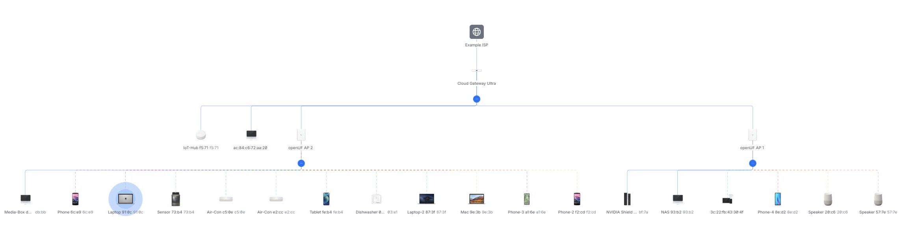
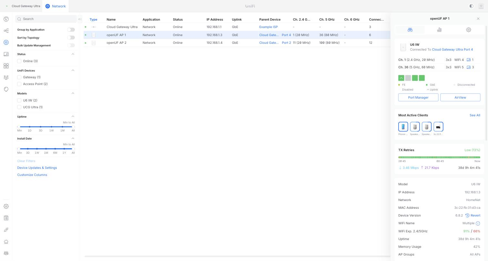
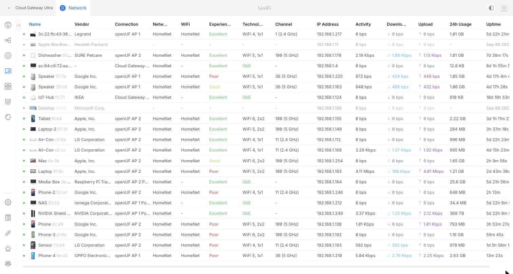

# openUF

[](https://github.com/jonasevcik/openUF/actions/workflows/test.yml)
[](LICENSE)
[](https://www.lua.org/)

openUF is a Lua daemon that makes an OpenWrt device appear as a **Ubiquiti UniFi U6-InWall** (or other UniFi AP models) to a UniFi Network Application controller.  The controller can then adopt the device, push SSID and network configuration, and display live client and radio statistics — all without genuine Ubiquiti hardware.

<p align="center">
  
</p>

<p align="center"><em>The controller's topology view: two openUF access points under a real UniFi Cloud Gateway Ultra, and all 20 clients on the network, 18 of them behind the openUF APs. Click for full resolution.</em></p>

<table>
<tr>
<td width="50%"></td>
<td width="50%"></td>
</tr>
<tr>
<td><em>Both openUF APs online as model <code>U6 IW</code>, with radios, uplink port, firmware version, 38 days of uptime and live throughput.</em></td>
<td><em>The controller's client list — most of these clients are associated to the two openUF APs on a controller-pushed SSID, with band, channel, WiFi generation and per-client experience.</em></td>
</tr>
</table>

Those are screenshots of the author's live network taken from a real UniFi Cloud Gateway Ultra; every hostname, MAC address, IP address, SSID and ISP name in them was rewritten to a consistent fake value in the browser before capture.

Tested end-to-end against **UniFi Network Application 10.4.57** — both a self-hosted Docker controller and a real UniFi Cloud Gateway Ultra adopting a TP-Link Archer C5 v1 running openUF, with real clients associating to the pushed SSID.  The default device identity presented is **U6-InWall** (model `U6IW`).  openUF emulates a UniFi **access point** only — gateway (USG) and switch (USW) emulation are not implemented and not planned.

Most rows below marked ✅ were verified by driving the real controller UI against a live openUF device and reading back the resulting wire capture; [PROTOCOL-VALIDATION.md](PROTOCOL-VALIDATION.md) records the evidence, including where a claim rests on decompiling the controller rather than a live capture.

## What it does

### Adoption and transport

| Feature | Status |
|---|---|
| L2 UDP discovery (port 10001) | ✅ Working: the periodic announce the controller adopts from. The same process also **answers** the discovery requests of the UniFi app, WiFiman's Discovery tab and the Device Discovery Tool (`01 00 00 00` → `01 00`, `02 08 00 00` → `02 09`, both captured from a real UCG Ultra, by broadcast, unicast or the `233.89.188.1` multicast group; targeted `01 04` is firmware-confirmed for UAP 4.0.15). IPv6 (`ff02::1`) probes are not answered. ⚠️ Lab-validated only: the home APs run with `l2_announce = false`, which turns the responder off with the broadcast |
| TNBU inform protocol | ✅ Working — AES-128-CBC and AES-128-GCM |
| AES-128-GCM | ✅ Working — **required**: 10.4.57 will not finish provisioning a device until it receives a genuine GCM inform. Needs a GCM-capable `lua-openssl` build |
| L2 adoption (SSH `syswrapper.sh set-adopt`) | ✅ Working — completes to **Connected** |
| L3 adoption (`set-inform`, no SSH) | ✅ Working — the controller skips SSH entirely and delivers the new authkey in the `setparam` `mgmt_cfg`; openUF accepts it only while unadopted. The controller chooses this path when it has *not* discovered the device via broadcast, which is what `config.l2_announce = false` is for — same-subnet devices that can't accept an SSH login need it |
| Zero-touch bootstrap adoption | ✅ Optional (`install.sh install --bootstrap-adopt`) — a locked-down, non-root SSH account auto-disabled after adoption |
| Forget device / factory reset | ✅ Live-confirmed: the controller's Forget sends `setdefault`. openUF then removes the WLANs, VLAN bridges, per-port VLANs and radio options it wrote, as UniFi firmware's factory reset does, but without a reboot. It keeps the inform URL, so the device can be adopted again straight away. `syswrapper.sh reset-inform` does the same, but starts over from conf.lua's URL. The controller forgets the device's own settings (name, channels, port VLANs, LED), as it does for a UAP |
| Restart / reboot command | ✅ Working |
| Immediate commands and config changes (STUN wake-up) | ✅ Working — **live on 10.6**. As UniFi firmware does, openUF keeps a UDP socket open to the controller's STUN server (`stun_url`, port 3478). It sends a Binding Request every 30 s and reports the mapped address as `connect_request_ip`/`connect_request_port`. When the controller queues a command or a config change, it sends a connection request to that address, and openUF informs at once instead of at the next heartbeat: 0.2 s after the request on the AX3000T, 1.5 s on the Archer C5 (most of that is building the payload). Runs only while adopted and the controller answers. After upgrading, it starts with the next config push (Force Provision once) |
| Firmware upgrade requests | Stored (version/url), never applied — flashing controller-supplied firmware onto non-Ubiquiti hardware would brick it |

### WiFi provisioning

| Feature | Status |
|---|---|
| Controller-pushed SSID provisioning | ✅ Working (UCI); only `openuf_`-prefixed sections are created or deleted |
| Exclusive-WLAN mode (`use_only_unifi_wlan`) | ✅ Working — default `true` disables hand-configured SSIDs so the radios carry only what the controller pushed; reversible (openUF stamps what it disabled) |
| WPA2 / WPA3 / WPA2-WPA3 mixed security | ✅ Working — derived from the pushed AKM set plus `wpa3.support`/`wpa3.transition`. Requires `radio_caps2` bit `0x1` on each radio, which openUF sends when hostapd can really do SAE — without it the controller silently downgrades every WPA3 WLAN to WPA2 |
| WPA-Enterprise (802.1X / RADIUS) | ⚠️ Wire → UCI → the device's own hostapd generator confirmed; **no client has authenticated yet**. The controller does push the servers (`aaa.<n>.radius.{auth,acct}.<k>.{ip,port,secret}`, `interim_update.*`, `dynamic_vlan`, `nas_identifier`) — an earlier release skipped such WLANs on the belief that it did not. WPA2, WPA3, WPA2/WPA3-transition and 192-bit Enterprise all map to an encryption the OpenWrt generator turns into `wpa_key_mgmt=WPA-EAP`/`-SHA256`/`-SUITE-B-192`, and 802.11r adds FT-EAP for free. The dummy `wpa.psk` the controller still sends on an EAP WLAN is dropped, so the BSS never carries a passphrase. **Trades**: one port and one shared secret per server list (OpenWrt's schema has no per-server pair — a server that differs is dropped with a log); RadSec/TLS servers are dropped rather than contacted in the clear; DAS/CoA and RADIUS MAC auth are not implemented; and with "RADIUS assigned VLAN: required" openUF writes `dynamic_vlan=2` but no VLAN map, so hostapd refuses a station whose assigned VLAN this AP has no network for — failing closed rather than putting it on the wrong network. A basic `wpad` has no RADIUS client; openUF logs a warning and provisions anyway, since the controller applies no capability gate |
| Hotspot 2.0 / Passpoint | ⚠️ Wire → UCI → hostapd confirmed, **no Passpoint client has associated yet**. A Passpoint WLAN is a WPA-Enterprise WLAN with an ANQP/GAS profile on top: openUF maps the WLAN's embedded `hotspot2` settings (`aaa.<n>.hs20.*`) onto `iw_enabled`/`hs20` and the interworking options, with the cumulative lists (`venue_name`, `nai_realm`, `roaming_consortium`, `anqp_3gpp_cell_net`, `domain_name`, `hs20_oper_friendly_name`, `hs20_conn_capab`) written as raw hostapd lines — OpenWrt's list options space-join into one line, which hostapd reads as a single malformed value. Needs **two** firmware capability bits: `fw_caps` `0x800000` (Hotspot 2.0) and `fw2_caps` `0x80000` (RadSec). openUF claims both when the local hostapd has the interworking options and `CONFIG_HS20`; without either, the controller rejects the WLAN with `api.err.DevicePasspointNotSupported`. **Trades**: openUF does **not** implement RadSec, yet the controller's validator demands that bit to reach Passpoint at all — claiming it is what makes the certificate filenames arrive, which openUF uses to **drop** a RadSec server instead of speaking plaintext RADIUS to it, so the claim is still the safer side of the trade. OSU/online sign-up, Passpoint icons, terms-and-conditions, HESSID, ANQP domain id, network auth type and QoS maps are not implemented: the controller does not send them on a WLAN (they exist only in its standalone Hotspot 2.0 profile schema), and this hostapd has no option for OSU or icons at all |
| Enhanced Open (OWE), incl. transition mode | ⚠️ Lab-confirmed on the wire, not yet on hardware: no OWE BSS has been brought up on a real AP. Needs `radio_caps2` bit `0x8`, which openUF claims when `hostapd -vowe` passes and the ucode wifi generator (24.10+) knows `owe_transition`. Without the bit the controller drops an OWE WLAN and sends a transition one as plain open. Transition mode is written as one `owe_transition=1` section. OpenWrt then names the hidden OWE BSS `<ssid>OWE`, where UniFi firmware reuses the SSID |
| PMF / 802.11w (`ieee80211w`) | ✅ Working — from `aaa.<n>.pmf.status`/`pmf.mode`. PMF is just PMF: the WPA3-transition signal is `wpa3.support`/`wpa3.transition`, not these keys |
| Fast Roaming (802.11r) | ✅ Working — **verified on real hardware** by forcing a roam and watching for `auth_alg=ft` with no EAPOL 4-way, both between radios on one AP and between two APs. Both the WLAN-level `ft.status` and the SAE-only `wpa3.ft.status` are read; FT is enabled if either asks for it, since OpenWrt cannot enable 802.11r for one AKM alone. On a **WPA3-only** WLAN the controller sends FT only to a radio claiming `radio_caps2` bit `0x2`, which openUF sets alongside `0x1` (⚠️ lab-confirmed on the wire; an FT-SAE roam on a WPA3-only WLAN is not yet verified on hardware). openUF sets the mobility domain (derived from the SSID, so every AP agrees without coordination) and keys the `r0kh`/`r1kh` key holders with the controller's per-WLAN `iapp_key`, the secret UniFi firmware uses (✅ identical on both APs; an FT-SAE `auth_alg=ft` with it confirmed between one AP's radios and, on 2026-10-11, between the two APs. A first attempt that day failed on a stale hostapd FT socket. openUF now watches for that and restarts wpad itself when no client is connected or in the 04:00 hour, see USAGE § 3; the detection is proven on a real kernel, the repair command by hand on hardware). Like UniFi firmware it also sets `pmk_r1_push=1` and a 3000 TU `reassociation_deadline` (✅ read back on both APs). It does not interoperate with real UniFi APs, which learn their peers through a Ubiquiti-only hostapd extension. It deliberately leaves `ft_psk_generate_local` alone — pinning it broke fast roaming for every WPA3 client, see USAGE § 3 |
| VLAN-tagged SSIDs | ✅ Working — verified end-to-end on real hardware with a client on a tagged IoT network. From `aaa.<n>.br.devname` (`br0.<vlan>`), the wire's only VLAN signal: openUF builds a `br-openuf<id>` bridge holding the tagged uplink sub-device, joins the VAP to it, and — on a swconfig board — trunks the VID through the switch (a DSA board needs no trunk: with bridge VLAN filtering off the switch passes tags through, and the sub-device on the uplink socket takes its VID before the bridge sees it — but that sub-device and the bare uplink are then one physical port on one switch with **one hardware FDB**, so openUF sets `learning '0'` on the tagged port; left learning, the switch files the upstream router's MAC under the VLAN bridge and blackholes every *wired* client's traffic to the gateway while WiFi clients, which take the software path, stay fine) — tagging the CPU port and the uplink socket only, never the LAN sockets, since on `ar8216`-family switches the tag flag is one global per-port bitmask and tagging a socket for the IoT VLAN makes it egress-tagged in VLAN 1 too, deafening the untagged wired client on it. Keep VLAN ids **below the switch's VLAN table size** (16 on some boards) — netifd has no `vid` option, so the id doubles as the table slot |
| Private Pre-Shared Keys (several passphrases on one SSID, each on its own VLAN) | ⚠️ Lab-confirmed on the wire and through to UCI, not yet on hardware: no client has joined with a VLAN key on a real AP. Needs `wifi_caps` bit `0x100000`, which openUF claims when the ucode wifi generator writes per-station VLANs (`vlanid=` in `ap.uc`, 24.10+) and hostapd is built with VLAN support. Without the bit the controller skips the WLAN entirely. Each key becomes a `wifi-station` section (any MAC) and each VLAN a `wifi-vlan` section bridged into the same `br-openuf<id>` a VLAN-tagged SSID uses, trunked the same way; a key on a VLAN-1 network puts its client on the WLAN's own network. A key whose VLAN openUF cannot build is left out, never downgraded to the untagged LAN. A UID IoT WLAN whose keys come from RADIUS only (`psk_radius=2`) is skipped, as WPA-Enterprise is. **WPA3 station keys** (the controller's `sae_psk`, sent as `sae.psk.<n>.{psk,mac,vlan,id}`, REST/API only) join them: a key bound to a MAC becomes a `wifi-station` for that MAC only, and the `ff:ff:ff:ff:ff:ff` entry (the WLAN's own passphrase) is skipped. ✅ Wire → UCI → hostapd's `.sae` file and VLAN netdev confirmed on both APs (2026-10-26, temporary WPA3-only WLAN with an any-station key, a MAC-bound key and a VLAN-10 key); ⚠️ no client has joined with one yet |
| Plugins (third-party extensions) | ⚠️ Unit-tested through `apply_config` with a mock UCI cursor; on real hardware (2026-10-25) a log-only plugin ran for both WLANs of an AP, and enabling it and removing it each made the controller push once more (a hostapd settings reload, not a restart). No plugin that changes hostapd behaviour has run yet. An opt-in hook (`config.plugins`, `/etc/openuf/plugins/<name>.lua`) lets a separate project edit the UCI options of each provisioned WLAN, for recipes that need extra software on the AP. Off by default, with the option set unchanged when empty. A plugin runs as root like `conf.lua`; third-party plugins are unsupported. Names come from `config.plugins` or `/etc/openuf/plugins.enabled`; a changed set triggers a re-push at the next start. See USAGE § 3 "Plugins" and [docs/PLUGINS.md](docs/PLUGINS.md) |
| Channel and TX power per radio | ✅ Working (Low/Medium/High/Custom; channel **Auto** is written through as UCI `channel=auto`, i.e. hostapd ACS picks on the AP; TX power **Auto** deletes the `txpower` option so the driver default applies again) |
| Radio enable / disable | ✅ Working — Transmit Power → **Disabled** arrives as `radio.<n>.status=disabled` (plus `wireless.<n>.status` on each of that radio's WLANs) → UCI `disabled`. Only an explicit value is written, so a push that omits the key leaves a hand-disabled radio alone |
| Device identity vs. management MAC | ✅ openUF identifies by `dev.conf.net.lan_cpueth`'s MAC but reports the IP of the bridge that port is enslaved to. Where those are different netdevs — DSA boards, where `lan_cpueth` names a socket carrying the label MAC while `br-lan` inherits the conduit's — the AP claims an address that ARP attributes to a different MAC, and the gateway raises an IP conflict against a correctly configured network. `ucihelper.ensure_bridge_identity` pins the bridge to the identity MAC at startup, only when they differ. **Verified on real hardware**, including the no-op path on a swconfig board |
| Channel width per radio | ✅ Working — from `radio.<n>.ieee_mode` (`11nght20`/`11naht40`/…), which carries the **band and the width and nothing else**: its `ht` is Atheros-era vocabulary, not a request for 802.11n (a real U6-InWall runs `11naht40` as HE40). openUF takes the width from the wire and the PHY generation from `iw phy`, then clamps down to what the radio really supports — a WiFi-6 identity also invites HE pushes at n/ac hardware, which hostapd would refuse to start on |
| IoT Optimization: Lock 2.4 GHz to Channel 6 / DTIM Interval Lock | ✅ Working — both are controller-side shortcuts that arrive as an ordinary `radio.<n>.channel=6` and `dtim_period=3`, needing no dedicated handling |
| IoT Optimization: Force WiFi 4 Mode | ✅ Wire protocol confirmed live (`wireless.<n>.iot` + `qbssload`); most of the mode arrives as ordinary keys (2.4 GHz-only, WPA2, PMF/BSS-transition/proxy-ARP off). Its one distinct effect, suppressing the QBSS Load IE via `bss_load_update_period`, is not verified against real hardware |
| BSS Transition (802.11v) | ✅ Working (`bss_transition`) — needs a full `wpad` build |
| 802.11k (per WLAN) | ✅ Lab-confirmed (`aaa.<n>.11k.status` from the wlanconf's `rrm_enabled`. REST only: the 10.6 UI has no control for it, and it defaults to off. Both values reached UCI: on → `ieee80211k`/`rrm_neighbor_report`/`rrm_beacon_report`=1, off → none of them). As on a UniFi AP (firmware 4.0.15, `iwpriv rrm`), the WLAN's toggle decides. Band Steering and Roaming Assistant still force 802.11k on, because usteer needs it. That is the case on the home APs, where the change was deployed and left hostapd unchanged. ⚠️ Without usteer nothing fills hostapd's neighbor list, so a client asking for a neighbor report gets no other AP. UniFi fills it from a scan at boot (`11k-boot`) |
| Band Steering | ✅ Working via `usteer` — requires the `usteer` package and a full `wpad` build (see Quick start). A real client was observed being moved 2.4 → 5 GHz by an accepted 802.11v BSS-Transition request; clients that stay put are the ones with no BSS-Transition support or no 5 GHz sighting. Switching it off is ✅ confirmed on hardware (`band_steering_interval` 0 in the running daemon). Until 2026-09-27 the off switch was an option usteer ignores, so usteer kept steering whenever it ran for Roaming Assistant. The AP's own Band Steering setting (device panel) is supported too: Prefer 5G is ✅ confirmed on hardware as far as the wire and the running daemon go (a real UCG Ultra pushes it, and usteer's steering interval turns on). ⚠️ A client steered by it alone has not been observed yet. Balance has no usteer equivalent and is ignored with a log line. Neither `bandsteering.mode` nor `prefer_5g`/`equal` occurs anywhere in the 4.3.28 or 6.8.2 firmware (the Wi-Fi 5 AP only gets the per-WLAN pairs and a kernel netlink steering module), so Balance's behaviour cannot be read from those builds |
| Airtime Fairness | ✅ On confirmed on hardware (both APs, all four radios: pushed by a real UCG Ultra, written and read back). ⚠️ Off is lab-confirmed here. A third party (the yesrab fork, mt7986/mt76, real UCG Ultra) confirmed Off on their hardware: `airtime_flags` read back 0 after the push. **Check the device's Airtime Fairness setting after upgrading:** a controller may hold it off from before openUF claimed the bit, and the first push then turns the kernel's fairness off. The device panel's Airtime Fairness switch reaches openUF only with `wifi_caps` bit `0x20`, which openUF claims where mac80211's per-phy `airtime_flags` exists in debugfs. On is the kernel's own default (every client gets an equal airtime share, and both APs already run it), so only Off changes anything: openUF writes 0 to `airtime_flags` and the scheduler stops charging airtime, i.e. plain round-robin. The setting is kept in `state.json` and reapplied at startup, since debugfs resets on reboot. hostapd's `airtime_mode` is not used: none of its modes switch the scheduler off |
| Auto 802.11 DTIM Period | ✅ Working — Auto and Custom both arrive as a concrete `dtim_period` |
| U-APSD (WMM power save) | ✅ Lab-confirmed both ways (`wireless.<n>.uapsd`, from the WLAN's `uapsd_enabled`), and confirmed on hardware: a real UCG Ultra (10.6) push turned `uapsd_advertisement_enabled` to 0 in every BSS on both APs. As on a UniFi AP (firmware 4.0.15, 4.3.28 and 6.8.2: key still consumed), the controller's setting decides: **off unless the WLAN enables it**, which is the controller's default. Before 2026-10-11 openUF ignored the key and OpenWrt's own default (on) applied to every SSID |
| Group Rekey Interval (GTK) | ✅ Lab-confirmed (`aaa.<n>.wpa.group_rekey`: the default 3600, 0 and 7200 each reached UCI `wpa_group_rekey`), and confirmed on hardware: after a push from a real UCG Ultra (10.6), hostapd ran `wpa_group_rekey=3600` in every BSS on both APs. As on a UniFi AP (firmware 4.0.15, 4.3.28 and 6.8.2: key still consumed), the controller's value decides, and **0 turns rotation off**. A WLAN created in the 10.6 UI may store 0 (both home WLANs did), so check the setting. Before 2026-10-11 openUF ignored the key and hostapd's default (86400 s) applied |
| Multicast Enhancement (multicast-to-unicast) | ✅ Working — from `wireless.<n>.mcast.enhance` |
| Multicast and Broadcast Blocker | ✅ Confirmed on real hardware. No hostapd/OpenWrt option exists for it, so it is enforced with nftables in a dedicated `bridge openuf_bcfilt` table: 14 of 14 broadcast frames from a non-allow-listed sender were dropped on the way out the VAP, 0 of 15 once that sender was allow-listed. **Needs `kmod-nft-bridge`** — the drop rule is openUF's only bridge-family `meta` match and a stock image has no `nft_meta_bridge`, in which case the table, chain and allow-list all still build and only the rule is rejected. **Blocks LAN→WLAN broadcast/multicast except from allow-listed source MACs — this breaks DHCP for wireless clients unless the DHCP server's MAC is on the list**, which is Ubiquiti's own documented behavior. The ruleset is rebuilt from UCI on every start, so it survives a reboot the controller does not re-push after |
| Minimum Data Rate Control | ✅ Wire protocol confirmed live (`wireless.<n>.minrate_data` + `beacon_rate`/`minrate_cck_rates.status`/`minrate_below_disable`). Applied per **radio** — OpenWrt's `basic_rate`/`supported_rates`/`legacy_rates`/`beacon_rate` are `wifi-device` options, so WLANs sharing a radio collapse to the most permissive floor. Turning the control off tears the options down again (marker-tracked, hand-tuned rates untouched) |
| Proxy ARP | ✅ Wire protocol confirmed live (`aaa.<n>.proxy_arp`) → `proxy_arp`. Needs a full `wpad` build (hostapd only compiles proxy-ARP support in with `CONFIG_PROXYARP`) |
| Client Isolation | ✅ Wire protocol confirmed live (`wireless.<n>.l2_isolation`) → `isolate` (hostapd `ap_isolate`) |
| Hide WiFi Name | ✅ Wire protocol confirmed live (`wireless.<n>.hide_ssid`, duplicated as `aaa.<n>.hide_ssid`) → `hidden` (hostapd `ignore_broadcast_ssid`) |
| MAC Address Filter | ✅ Wire protocol confirmed live. Arrives in a top-level `macacl.<m>.*` section keyed by **devname**, not by WLAN index, so it is joined on `wireless.<n>.devname` → `macfilter` + `maclist`. Allow/deny policy maps 1:1 onto OpenWrt's; enforced by hostapd itself |
| WiFi Speed Limit | ✅ **Per client**, as UniFi firmware does it (read from 4.0.15's `libubnt`) and as the controller's UI describes it: each client on a limited SSID gets the profile's rates, and both directions are **queued**, not dropped. Live 2026-10-11 on both APs (ath9k, ath10k, mt76) with a temporary 5/2 Mbps SSID: a phone got its own class each way and held 4.5–4.7 Mbit/s down and 1.94–1.97 Mbit/s up (measured at the AP over each test window). A client's own profile and a guest's portal limit (`rate-update`) replace the WLAN's for that client; the controller re-sends them on every connect, roam and reconnect, which the Docker lab showed. Broadcast and multicast are not shaped. **Needs `tc-tiny` and `kmod-ifb`**: without `kmod-ifb`, upload drops the excess instead of queueing it (needs `kmod-sched-act-police`), and openUF logs that once. Two firmware behaviours kept on purpose: moving a client back to the Default profile lifts its limit until it reconnects, and the 64 kbps guaranteed minimum is not applied. The limit is reapplied from UCI and the client list on every heartbeat, so it survives reboots and Wi-Fi reloads |
| Roaming Assistant | ✅ Working — **verified on real hardware**: a client stuck at −80 dBm on one AP was moved to the other AP (−61 dBm) and stayed there for the 30 min watched. Per WLAN, 5 GHz. A weak client gets an 802.11v request toward an AP that hears it at least 8 dB louder, then a disassociation if it stays; a client with no better AP is left alone. Needs `usteer` on every AP (see USAGE § 3). usteer's once-a-second AP-to-AP broadcast is kept off the VAPs (✅ verified on both hardware APs: per-client traffic fell from ~535 KB to 6–17 KB per 30 s while each usteerd still saw the other AP), so clients no longer receive a unicast copy of it Leaving a client alone when no better AP exists is unit-tested only: no such client was present during the hardware run |
| Minimum RSSI | ⚠️ Per **radio**, not per WLAN, and enforced the way UniFi's own firmware does it: hostapd ignores probes and refuses association from clients below the threshold + 3 dB, and a connected client below the threshold for 30 s is deauthenticated once (a kick, not a block). The 3 dB gap stops a weak client from looping kick → rejoin. Disabling it in the controller removes both. Confirmed on real hardware that the setting reaches hostapd's live config and is removed again; an actual refused or kicked client has not been observed (unit-tested only) |
| Load balance (per-radio client cap) | ⚠️ Set over the controller's REST API (`radio_table[].loadbalance_enabled` + `maxsta`); 10.6's UI has no control for it. As on a UniFi AP, when a radio has more clients than the cap, openUF deauthenticates the most idle ones once each (a kick, not a block), and nothing stops a new client from joining. Lab-confirmed that the setting is stored and removed; on hardware the idle-time reading works on ath10k and mt76, but no real kick has been observed |
| Show Access Point Name in Beacon | ❌ **Not implemented on the OpenWrt side.** The wire protocol and its `wifi_caps2` bit `0x40` gating are confirmed live, and openUF writes `wps_device_name`/`ap_setup_locked` — but a beacon never carries the name. OpenWrt emits the whole WPS/WSC block, `device_name` included, only when `config_methods` is non-empty, which needs `wps_pushbutton` or `wps_label`; openUF sets neither, so WPS never activates. Verified 2026-09-10 on an Archer C5 and an AX3000T (both 25.12.5): the gate is `/usr/share/ucode/wifi/ap.uc:227`, and no live BSS config carries a single WPS key. Enabling WPS to broadcast a name is a real security surface for a cosmetic feature, so this is left unimplemented deliberately |
| WiFi Blackout Schedule (WLAN Schedule) | ✅ Confirmed on hardware (both APs, ath9k, ath10k and mt76, pushed by a real UCG Ultra on 10.6): a WLAN goes off the air for its blackout windows and comes back after, within one heartbeat of the window's edges, without touching the other SSIDs. As on a UniFi AP (firmware 4.0.15, 4.3.28 and 6.8.2: key still consumed), the BSS netdev goes down for the window. Before the clock is known to be right (a controller answer agreeing with it), nothing is taken down. openUF claims `fw_caps` `0x1000`, so a day with several windows arrives intact. ⚠️ While a WLAN is blacked out, hostapd logs "Failed to set beacon parameters" every few seconds for each blacked-out BSS while usteer runs; it is harmless but crowds the system log. Not yet observed with a client connected as a window starts |
| SAE tuning (Anti-clogging, Sync Time, groups) | ✅ **Confirmed on hardware** (2026-10-26, both APs, all radios, temporary WPA3-only WLAN): `aaa.<n>.sae.anti_clogging`/`.sae.sync` reach hostapd as `sae_anti_clogging_threshold=`/`sae_sync=`, and `sae.groups` as `sae_groups`, as UniFi firmware writes them (firmware-confirmed for 6.8.2). Only on a WLAN that offers SAE. They are not wifi-iface options, so they go in as `hostapd_bss_options` raw lines (ucode generator, 24.10+; older releases drop them). A WPA2/WPA3 WLAN now carries the controller's default 5/5, which is hostapd's own default |
| Key caching, TDLS and the Country IE (`auth_cache`, `tdls_prohibit`, `country_beacon`) | ✅ **`tdls_prohibit` and `country_beacon` live-confirmed on both APs; `auth_cache` lab-only.** All three are wlanconf fields with no control in the 10.6 UI, so they are set over REST, and all three were confirmed to change the push (2026-10-26, 10.6.106) rather than being decoys. `auth_cache` (default **on**) rides only the WPA-Enterprise branch and becomes `okc`; `tdls_prohibit` is on every WLAN and maps 1:1. `country_beacon` is per-WLAN on the wire but per-radio in OpenWrt (`ieee80211d`), so openUF turns it on for a radio if **any** WLAN on it asks — the Country IE is an advertisement, not a restriction. A real Force Provision from the production controller (2026-10-27) wrote `tdls_prohibit='0'` per WLAN and `ieee80211d` per radio into UCI on **both** boards, and hostapd re-emitted `tdls_prohibit=0` in every BSS block with no config errors. **On 5 GHz the Country IE cannot be turned off**: hostapd refuses the whole interface with *"Cannot enable IEEE 802.11h without IEEE 802.11d enabled"*, and 802.11h is what OpenWrt emits for every 5 GHz radio with a country — so the controller's "off" is honoured on 2.4 GHz only and the radio keeps `ieee80211d=1`, with a log line saying so. That was found the hard way: the first version wrote `ieee80211d='0'` on every radio, and the next ordinary config push took the 5 GHz radio down on **both** APs with `hostapd.add_iface failed` (no SSID on the air, nothing in UCI to explain it). The failure lands at the next `wifi reload`, not at the push that writes the option, which is why reading UCI and `hostapd-phy*.conf` straight after the provision looked clean. What is **not** claimed is `auth_cache`→`okc` on hardware: neither AP runs a WPA-Enterprise WLAN, so that branch has only ever been exercised in the lab |
| Pairwise cipher (`wpa.1.pairwise` / wlanconf `wpa_enc`) | ⚠️ **Lab-confirmed on the wire; the hardware part proven is the capability probe, not a push.** The controller's own cipher choice now wins over openUF's derivation: `ccmp-256` and `gcmp` become an `encryption` suffix (`psk2+gcmp`), `CCMP` writes nothing because it is OpenWrt's own default, and `gcmp-256` cannot arrive — the controller's validator refuses it. **Gated on the radio**, because hostapd treats an unprogrammable cipher as fatal and the BSS never comes up: openUF reads the phy's cipher suites over nl80211 (`iw` 6.17 does not print them) and keeps the default where the cipher is missing, with a log line. ✅ The probe is confirmed on both boards, and the asymmetry it exists for is real — the Archer C5's ath9k 2.4 GHz radio reports GCMP while its ath10k 5 GHz radio reports CCMP only. A real push on both APs (2026-10-27) carried `CCMP`, and openUF correctly wrote no suffix — hostapd kept `wpa_pairwise=CCMP`. **Trade**: `TKIP CCMP` (a WPA1 WLAN) is declined outright |

### Reporting and statistics

| Feature | Status |
|---|---|
| Wireless client statistics | ✅ Working — per-client traffic, signal, MIMO/generation, TX MCS (`vap_table[].sta_table`). As UniFi firmware sends them: `rssi` is the SNR (it was the dBm signal), plus the radio's `noise` and `is_11r` for a client on an 802.11r (FT) key. openUF no longer sends `capacity`, `throughput`, `linkscore` or `multicast` (until 2026-10-11 these were a tx-rate proxy, a byte rate and two zeros). The firmware doesn't send them, and the controller reads them only for mesh uplinks. ✅ Live on both APs and a 10.6 controller. Power save (`powersave_enabled`) is reported only where mac80211 tracks it (ath9k here); ath10k and mt76 leave it to the driver, which does not say, so it reads off there. ⚠️ The ath9k path is checked against live debugfs, not yet seen as `true` on the controller |
| Radio statistics | ✅ Working — channel utilization (over the last inform interval, as firmware reports its last ~1 s; it was a since-boot average before 2026-10-13), avg. signal/interference/airtime, per-VAP "Air Stats" (mt76: underflowed retry counters read as 0, drops = failed − retries), per-client "TX Retries" (✅ live on a 10.6 controller; it read 0.0 % for every client before 2026-10-13) |
| "Possible interference" warning | ✅ Working on **ath9k** radios — **live on 10.6**. As UniFi firmware does, openUF sends the radio's hardware transmit-timeout and carrier-sense-timeout counts (`athstats.ast_txto`/`ast_cst`, from ath9k debugfs `GTT`/`CST`). The controller logs the warning when either rises faster than 10/s. ath10k and mt76 radios keep no such counters, so they never raise it. Event confirmed in the lab with synthetic counts; on real radios the counts rise far below 10/s, so it has not fired there |
| Device load and memory | ✅ Working — **live on 10.6**: the device panel shows **Memory Usage** (`system-stats`) and **Load Average** (`sys_stats`, `/proc/loadavg` verbatim). `sys_stats` also carries memory in bytes, as UniFi firmware sends it. Each VAP reports which side of the primary channel its secondary 20 MHz channel sits on (`extchannel`); the UI uses it to centre a 40 MHz 2.4 GHz channel |
| WiFi Experience / satisfaction score | ✅ Working — UniFi's own formula, ported from the AP firmware (`calc_sta_satisfaction` in libubnt, firmware-confirmed for 4.0.15). A client scores the lowest of: SNR, the mean of its tx and rx rates in fixed steps, and retries per frame over the last full minute less frames dropped. With it go the reason (which term set the score), the anomaly bits, per-WLAN anomaly and reason charts, a per-radio score (the controller showed −1 for every radio before) and −1 for a WLAN or AP with no clients. ✅ Live on both APs and a 10.6 controller. The firmware's TCP-loss, TCP-latency and WiFi-latency terms come from its own driver and have no mac80211 source, so they always score 100. Trade against the earlier estimate: 2.4 GHz single-stream clients top out at 85 (72.2 Mbit/s sits in the firmware's 54–100 Mbit/s step), where they read 100 before. A 10.6 controller behind a UniFi gateway lists `anomalies` as −1: the gateway's own report of each client overwrites the AP's, as it would a UniFi AP's |
| Ethernet port statistics (`port_table[]`) | ✅ Working — one entry per **physical socket** on swconfig boards, each with the link speed and duplex that socket actually negotiated, read from the switch (the CPU netdev only ever knows the internal SoC↔switch link, which is always 1000/full). Which socket is the uplink is detected from the switch's ARL table, so it follows the cable. Per-port byte counters from the switch's MIB, which openUF switches on at startup where the driver ships it off (`ar8xxx_mib_poll_interval`); packet/multicast/broadcast/drop counts are not available per socket, so those columns stay empty rather than carrying the CPU port's totals. Anomaly, STP and Profile are controller-side or USW-only — they read `-` for a real UniFi gateway's ports too. On a **DSA** board (no `swconfig`) the same shape comes for free from sysfs — each socket is its own netdev there, so its speed and duplex are its own — and the uplink is detected from the bridge FDB instead (`bridge fdb show br br-lan` names the port each MAC was learned on). Boards where neither source can answer keep the netdev-based single-port shape and a statically flagged uplink |
| Wired client statistics (`port_table[].mac_table`) | ✅ Working — hosts are placed on the socket they are really plugged into, from the switch's ARL table on swconfig boards (there `bridge fdb` can only ever say "behind the CPU port") and from the per-socket bridge FDB on DSA, where each socket is its own bridge port. Each socket is asked about **its own** bridge, not the uplink's, so a socket openUF has moved into a VLAN bridge still reports its hosts; where that socket has MAC learning off (see per-port VLAN below) the FDB has nothing to say and the hosts come from an nftables tap instead. The uplink socket reports none, and neither does a socket on a VLAN openUF does not carry (a swconfig board's WAN socket stranded on VLAN 2 — a host there is not reachable on the LAN it would be listed in). The AP's own MACs and its wireless stations are never reported as wired clients. Rows carry `vlan` (from the bridge the socket sits in) and an `ip` harvested with them, which is what puts the client on the right *network* as well as the right port: the controller matches a wired client to a network by the row's `vlan`, defaulting to 1, and never sees an ARP entry for a VLAN the AP holds no address on. ⚠️ Behind a UniFi gateway, these clients' **usage history** (24 h / hourly / daily) is wildly inflated, up to terabytes. The live totals are correct. This is a controller collision: the controller writes every AP-reported wired host into the per-client history with no byte counters, and a UniFi gateway writes the same client with its lifetime counter, so each switch between the two adds the whole lifetime counter again. It goes by device type, so a real U6-IW should do the same. openUF leaves it alone because the only fix is to stop reporting the hosts (PROTOCOL-VALIDATION "A wired client's usage history grows") |
| Environment / rogue-AP scanning (`scan_radio_table`) | ✅ Working — confirmed rendering live in the Environment tab. Read from the kernel's passive BSS cache, so on its own it lists only neighbours on the radio's **own** channel; openUF never dwells off-channel behind a client's back |
| Sibling-AP recognition (no false "impersonator" warnings) | ✅ Implemented — the controller takes the scanning AP's `is_unifi`/`serialno` tag as the only proof a BSS is the site's own. openUF APs beacon a vendor element with their device MAC and tag each other; without it every other openUF AP was flagged as a third-party AP broadcasting your SSID. openUF also reads a real UniFi AP's own element (decoded from the firmware), so on a mixed site openUF reports genuine UniFi APs as UniFi too: seen on hardware with a current-firmware UniFi AP. The reverse does not hold: a real UniFi AP still reports openUF APs as third-party, because openUF does not beacon Ubiquiti's element (a real AP would act on its flags) |
| RF environment enrichment (802.11k beacon reports) | ✅ Working — the same mechanism Ubiquiti's Channel AI describes as *"neighbor reports and automated RRM scans"*. openUF periodically asks one 802.11k-capable **client** to sweep and report back; the client goes off-channel, the AP never does. Took a 5 GHz radio's Environment list from **0 neighbours to 4**, including an AP it cannot itself hear. Rows carry the neighbour's SSID, security and channel width, read from hostapd's control socket (`BEACON-RESP-RX`), which carries the neighbour's beacon as the client heard it. hostapd's ubus event has only the BSSID. This AP's own BSSIDs and its siblings' are left out. Signal is calibrated per client, because some clients write signed dBm into the RCPI byte. ✅ Lab: an injected live report reached the controller with SSID, `wpa2`, 80 MHz and primary channel. One client is asked per hour (`rrm_request_interval`), because hostapd logs every report to syslog. Off with `rrm_enrichment = false` |
| WiFi Connectivity (Insights → AirView → Connectivity) | ✅ Working. Before this the view read **0 %** on every stage with *"Initial WiFi Connections (0)"*: the controller builds it only from per-connection notifs that openUF never sent. openUF now reports each connection's Association, Authentication, DHCP and DNS stages with real timings, from hostapd's connect events and a passive nft table that dates each station's first DHCP and DNS frames. ✅ Live on the real controller: a Pixel 3 reconnecting to the AX3000T showed up as a successful attempt (association 10 ms, authentication 120 ms, DHCP 120 ms, total 320 ms). ✅ Lab: a DHCP timeout appears as a DHCP-stage failure. A client that sends no DNS query within 30 s of connecting is not reported, because the controller's Success rule needs a DNS answer. Off with `assoc_tracker = false` |
| Roaming events (Insights → AirView → Roaming) | ✅ Working. Before this every roam read "Success" with no tags: the controller derived roams from client moves between heartbeats. openUF now reports each arrival and departure as UniFi APs do, and claims the capability that makes the controller use those reports instead (`wifi_caps2` `0x2000`, only while they are sent). Failed roams show with their disconnect time, and roams carry the Fast Roaming, Roaming Assistant and Minimum RSSI tags. The AP a client left without a word (802.11r, or just associating elsewhere) learns of it from its bridge, which sees the client's address arrive from the uplink in the same second. ✅ Live on the real controller: a phone that left one AP without a word showed as a successful roam (the old AP's own drop came 16 s later, too late to pair), a phone forced off one AP showed as a failed roam, and a band change within one AP added no roam. ✅ Fast Roaming and Roaming Assistant tags seen live on roams nobody forced. ⚠️ The Minimum RSSI tag is lab-confirmed only. The AP a client left stops listing it at once, as a UniFi AP drops it: listed, the controller's 10.6 fallback recorded the roam a second time, without tags. ✅ Lab: a fast roam stored as Success with Fast Roaming, a 3 s gap as Failed. Needs `ip-bridge` (without it a silent roam is reported only when the old AP drops the client, too late to pair). Off together with the Connectivity reports (`assoc_tracker = false`) |
| LLDP topology announcement | ✅ Working (via `lldpd`) — **set `lldpd.config.cid_interface` to your LAN network**, or the controller shows the wrong Parent Device: lldpd's default chassis ID is some other interface's MAC, which the controller can't match to the MAC openUF is adopted under. See [USAGE](USAGE.md#7-lldp-topology) |
| RF/spectrum scan (Airtime Scan) | ✅ Live-confirmed on a real UCG Ultra: Scan Now scans channel by channel with the WLANs up (clients see ~200 ms bumps, not a disconnect), and the Environment tab charts per-channel utilization at 20/40/80 MHz. Coarser than a UniFi AP's own scan: survey busy time from a 200 ms listen per channel and the noise floor, not Qualcomm spectral analysis. The panel shows "Scanning..." until the page is reloaded (a frontend quirk) |
| DFS radar detection (event + alert) | ⚠️ **Lab-confirmed end to end; no live radar hit captured — radar cannot be produced on demand.** A radar detection on a DFS channel takes the radio off it for 30 minutes, and until now openUF reported nothing: the controller's own log read as if the AP had simply changed channel. openUF now sends it as the AP's event, `EVT_AP_RadarDetected` with the channel and frequency, so the controller logs *"&lt;AP&gt; detected radar on channel 100 (5500 MHz)"* and raises the matching alert. Read off hostapd's control socket (`DFS-RADAR-DETECTED`), whose `freq` is where the radar was — not the BSS's centre frequency. Of the eleven `EVT_AP_*` events 10.6.106 has a handler for, this is the **only** one a UniFi AP sends: the other ten appear nowhere in U7LR 6.8.2's binaries, so the controller raises them itself. ✅ Lab: the controller's handler accepted the payload, and the same event with `channel` left out was refused with *"Event without handler"* — so the field set is the handler's own. One hit on a radio with several BSSes is reported once. The event is sent whether or not 802.11k enrichment or connection tracking is on |

### Device management

| Feature | Status |
|---|---|
| Locate (LED identify blink) | ✅ Working — requires `dev.conf.led` set per board, naming an LED that is **actually wired** (see USAGE § 3). The LED need not be a dedicated status light: Locate snapshots whatever trigger it was driving, persists it, and restores it on stop, so it survives a restart landing between the controller's `set-locate` and `unset-locate` — and an interrupted Locate is torn down at the next start rather than blinking forever |
| Manage → LED steady on/off toggle | ✅ Working — same `dev.conf.led` requirement. Persisted and re-applied at startup, so it survives a reboot; it is also re-asserted when a Locate ends, since restoring the blink's previous trigger alone would leave a status LED dark |
| L2 hardening (the controller's `ebtables.*` rules) | ✅ Working (unit-tested; the rules are loaded on both APs, read back with `nft list`; no frame has been sent at them yet). UniFi firmware replays the same rules verbatim as ebtables (firmware-confirmed for 4.0.15, 4.3.28 and 6.8.2: same `ebtables.rule` replay). The BPDU drop (in and out) and the inbound 802.1Q-tag drop the controller pushes for every SSID are enforced as nftables rules in `bridge openuf_l2guard`, on the AP VAPs only. The rules are rebuilt at start and whenever the VAP list changes. **Needs `kmod-nft-bridge`** (see USAGE § 6) |
| Client block / unblock | ✅ Working — enforced via nftables, persists across restarts. A blocked client is also refused by hostapd on every SSID, as UniFi firmware's driver does: hostapd's deny list gets the MAC on every SSID. A WiFi restart empties that list, so openUF checks it again at once when hostapd recreates an SSID (or restarts), on every heartbeat for a minute after a config push, and otherwise once a minute. After a WiFi reload openUF did not run (LuCI, `wifi reload` by hand), a blocked client can reassociate for up to a minute, with its traffic still dropped. Before 2026-10-10 a blocked client could reconnect and sit on the SSID with no traffic. ✅ The list confirmed in live hostapd on both APs; a refused real client has not been observed yet. A newly blocked client is also deauthenticated at once on whichever SSID it is on (before 2026-10, only the first SSID of each radio was tried, so a client on a second SSID kept its association until it next reconnected). Every config push also carries the site's whole block list (`blocked_sta`), and openUF now applies it, so a missed block/unblock command is corrected on the next push. ✅ Lab: block, unblock and the empty list. Both APs run it and agree with the real UCG's empty list |
| Client → Reconnect | ✅ Working. The controller's `kick-sta` is a one-shot deauth on every SSID, not a block: the client may come straight back. ✅ Live on the AX3000T: a Pixel 3 was deauthenticated ("local deauth request") and reassociated on its own 61 s later, with no block-table entry. ✅ Lab: the controller queues the command to the AP the client is on |
| Guest portal (Hotspot) | ⚠️ **Lab-validated only, never run on hardware. Don't use it on a real guest WLAN yet.** In the Docker lab, the whole portal loop works. A guest who hasn't logged in is blocked, except for DHCP, ARP, DNS and the portal itself, and their first plain-HTTP request is redirected to the controller's portal with the guest's MAC attached. Logging in there makes the controller send `authorize-guest`, and openUF lets that MAC through (the private subnets the controller restricts stay blocked). `unauthorize-guest` blocks the guest again and disconnects it, as UniFi firmware does, so its device shows the portal again when it reconnects. Turning the portal off removes every rule. A per-guest speed limit (`rate-update`) is a per-client WiFi Speed Limit like any other (see that row). If the AP loses its controller, `selfrun_guest_mode` decides what guests get, as in UniFi firmware (read from builds 3.9.27–4.0.15): after 3 unanswered informs, `pass` (the default) lets every guest through (the restricted subnets stay blocked), and `off` takes the guest WLANs down. The controller's first answer undoes either. `off` is hardware-tested on its own (temporary WLANs on ath9k, ath10k and mt76 went off the air and came back with their beacons); the rest of the portal is not. openUF also reports the `guest_token` the controller requires before it authorizes anyone, and each station's portal state; without that state, the controller sent `unauthorize-guest` for every guest on every heartbeat. The **walled garden** ("Pre-Authorization Access") is enforced in both of its forms since 2026-10-26: an IP or CIDR entry travels as an ebtables rule (and was silently unenforced before, along with its egress twin — the portal's own accepts carry a port, a garden entry does not), while a domain entry travels as a `dnsmasq.walled_garden` key, which openUF resolves on the AP with `nslookup` and re-resolves every ten minutes, exactly the job the controller asks the device to run. The resolved addresses are kept in `state.json`, so a reboot rebuilds the rules without waiting for DNS and a name that stops resolving keeps the addresses it had instead of silently opening or closing the garden. Narrower than UniFi firmware, on purpose: DNS passes for everyone (openUF runs no resolver), HTTPS is dropped rather than answered, the redirect only works where the AP has an IPv4 address on the guest network's bridge (elsewhere, guests are blocked but see no portal), and the garden is IPv4-only and resolved on the AP, so a name whose answer differs from the client's (a CDN) can be reachable by an address openUF never saw — the firmware has the same limit. A domain-only *restricted* list never arrives at all: the controller sends the whole garden block only when the allowed list has a domain in it. Needs `kmod-nft-bridge`. See USAGE § Guest portal |
| IP Settings (DHCP / static) | ✅ Working — reconfigures the device's own management interface, including the DNS servers (`resolv.nameserver.<k>.ip` → `/etc/resolv.conf`, in the controller's primary/secondary order). DNS is applied on the static path only; on DHCP the lease supplies it. A static address is re-applied on every start, so it survives a reboot the controller never re-pushes it after |
| Per-port VLAN assignment | ⚠️ Wire format fully mapped live (`switch.*`: device-level gate, per-VLAN table, per-port `pvid` plus a tagged/untagged/`exclude` matrix joined on `port_table[].port_idx`); requires reporting the `hasOWRTSwitch` capability bit and ticking **Port VLAN** on the device. Applied two ways depending on the board. On **swconfig** boards, as `switch_vlan` sections; requires a `dev.conf.vlan` port map plus a `swport` on the port, never touches the socket the uplink cable is in (detected at runtime, and refused outright when it cannot be determined), and is reversible — unticking the device-level **Port VLAN** box tears openUF's sections down and restores the stock port strings. The generated UCI is unit-tested, but that it programs a real switch ASIC is **not verified** (no switch hardware here). On **DSA** boards there is no switch table to write and `bridge-vlan` is deliberately not used: the assigned socket is moved out of `br-lan` and into that VLAN's `br-openuf<id>` bridge — the same L2 a tagged SSID on the same VLAN already uses, since they are one broadcast domain. `br-lan` keeps the uplink and the management address and nothing ever runs with `vlan_filtering`, so a wrong answer cannot strand the AP. A moved socket also gets **MAC learning turned off** (`openuf_brport<vid>_<socket>`): the VLAN bridge is software-only but the socket shares one address table with the uplink, and an entry learned there makes the switch resolve the reply in hardware to a port outside the uplink's bridge and drop it — outbound stays perfect, so nothing else reveals it. **Verified on real hardware** (full DHCP handshake captured at three points, with and without); Native VLAN only (a tagged-only port is refused out loud). Because that empties the socket's bridge FDB, openUF also installs a `bridge openuf_learn` nftables tap that harvests source MACs *and* IPv4 addresses on the moved socket, so the port keeps reporting its wired clients and they still land on the right network — the socket's bridge cannot be hardware-offloaded, so every frame on it reaches the CPU where the tap sees it |
| Timezone, NTP servers, nightly neighbour scan | ✅ Working (unit-tested, and read back on both APs: the site timezone and NTP servers are in UCI and the cron block is installed). The site timezone and NTP servers from every full push go to UCI `system`, with the board's originals stamped alongside (`openuf_*_orig`). The controller's nightly `syswrapper.sh 11k-scan` cron job is installed in a marked block of root's crontab. As on UniFi firmware, that job scans every radio twice at random times within the next hour, so APs whose cron fires at the same second do not all go off-channel together. The fresh neighbours ride out on the inform after each scan. Only commands openUF provides are ever put in cron (see USAGE § 6) |
| On-demand neighbour scan (`scan`, Radio AI `scan_band`) | ✅ Working. The controller's `scan` (REST `cmd/devmgr`) and Radio AI's full-scan `scan_band` now trigger a real sweep of the requested radio or band, and the fresh neighbours go out on the immediate re-inform, which is what clears the controller's "scanning" flag. Before, both were silently ignored, so Radio AI got only whatever the kernel's scan cache already held. ✅ Lab: both commands sent by the controller and answered. ✅ Both APs, 2.4 GHz: the sweep runs on the right radio and the scan results are fresh. 5 GHz is swept by the same code path as the nightly scan |
| Set Replacement Device / Load Configuration | ✅ Working — both are controller-side clones; no device-side protocol involved |
| Power / PoE reporting | Not applicable — the flagged UI field belongs to the upstream parent device, not the AP |
| Speed test | Not applicable — gateway-only feature in current UniFi Network |
| SSIDs on uplink loss | Matches UniFi firmware for this config. A UniFi AP takes its SSIDs down when it loses the gateway, but only when the controller sends `connectivity.status=enabled`. The controller does that only for devices that claim wireless-uplink (vwire) support, which openUF cannot do, so it sends `disabled`, and a UniFi AP would keep its SSIDs up too. Confirmed on a UCG Ultra and the 10.4.57 lab. See PROTOCOL-VALIDATION.md § `connectivity.*` |
| USG / USW emulation | Not implemented, not planned |

## Supported hardware

A dual-band OpenWrt device with **at least 16 MB flash**, and roughly **5 MB free on
`/overlay`** after the stock image.  8 MB is not enough: the AES-GCM backend
(`lua-openssl`) pulls in `libopenssl3` at ~4.35 MB, and adoption cannot complete without
GCM — a stock 8 MB build leaves only ~1.6 MB of overlay, which no crypto backend fits in
(`openssl-util` and `luaossl` depend on the same library).  Measured on a TL-WDR3500 v1,
which is 3.2 MB short and therefore **cannot run openUF from a stock image** — it needs
USB extroot or a custom build with the crypto baked into squashfs.  Known-working:

- **TP-Link Archer C5 v1** (dual-band 802.11n/ac) — use `modelmap/archer-c5-v1.lua`.
  **The reference device**: install, adoption, the WiFi config push, live clients and the
  radios themselves are confirmed on this board (OpenWrt 25.12.5) against a real UniFi Cloud
  Gateway Ultra — see [PROTOCOL-VALIDATION.md](PROTOCOL-VALIDATION.md#the-first-real-hardware-run)
- **TP-Link TL-WDR3500 v1** (dual-band 802.11n, 2x2) — use `modelmap/tl-wdr3500-v1.lua`.
  Adoption, SSID provisioning, 802.11r/k/v, Band Steering, Minimum RSSI and WiFi Speed
  Limit all confirmed on real hardware against a UCG Ultra.
  ⚠️ **8 MB flash: does not fit a stock image** (see the space requirement above) — it needs
  a custom build with the crypto in squashfs. Even then **`nftables` typically does not fit**
  (~490 KB with its kernel modules), which leaves two features unavailable on this board:
  **client Block/Unblock** and the **Multicast and Broadcast Blocker**. Its radio order is
  also the reverse of the Archer C5's — `radio0` is 2.4 GHz here
- **Xiaomi Mi Router AX3000T** (dual-band 802.11ax, 2x2) — use `modelmap/xiaomi-ax3000t.lua`.
  The first **DSA** board here (mediatek/filogic, MT7981) and the first with real 802.11ax:
  HE on both bands, 160 MHz on 5 GHz, nothing clamped except the 40 MHz ceiling 2.4 GHz has
  anyway. Plenty of room — 128 MB RAM, ~56 MB free overlay, every optional feature fits.
  Two board notes: its four sockets are the netdevs `wan`/`lan2`/`lan3`/`lan4` (there is no
  `lan1` — DSA names ports from the device tree, not the case labels), and it exposes **no
  status LED** (`/sys/class/leds` holds only the two mt76 radio LEDs), so Locate blinks
  `blue:status` — **install `kmod-leds-gpio`** (9 KB) or the board has no drivable LED at
  all: its case LED is a blue/yellow GPIO pair the stock filogic image ships no driver for,
  leaving it stuck on whatever the bootloader set (a steady orange). `install.sh` adds the
  module when it sees that situation. Do not point `dev.conf.led` at `mt76-phy0` instead —
  it exists and accepts writes, but is wired to nothing on this board
- **BT Home Hub 5 Type A** (dual-band 802.11n/ac) — use `modelmap/bt-homehub-v5a.lua`.
  lantiq/xrx200 with a DSA switch (GSWIP): `lan1`..`lan4` are bridge ports of `br-lan`, the
  `wan` socket is not used by an AP and not reported. `radio0` is 5 GHz (ath10k, QCA988x),
  `radio1` 2.4 GHz (ath9k). Adoption, the WiFi config push and live clients are confirmed
  on OpenWrt 25.12.6 against a UCG Ultra; plenty of room (~98 MB free overlay, ~35 MB RAM
  available before openUF). Locate drives `green:broadband`, the DSL LED, which has no
  other consumer on an AP. Not yet confirmed on this board: `install.sh`, the controller's
  radio settings (channel, width, power) and Locate itself. VLAN-tagged SSIDs build on
  `lan1`, so they assume the uplink cable is in `lan1`
- **TP-Link WR1043ND v2** (single-band 802.11n) — use `modelmap/tl-wr1043ndv2.lua`

The *modelmap* describes your real hardware; the *ufmodel* picks the UniFi identity to present.  `ufmodel/u6iw.lua` (U6-InWall) is the default and the only one validated end-to-end — `uapg1`, `uapg1-lr`, and `uapg2-ac-lr` are also provided but untested.

## Quick start

```sh
# 1. SSH into the OpenWrt device, install dependencies (OpenWrt 25.12+ uses apk;
#    on 24.10 and earlier the same names go through `opkg install`)
apk update
apk add lua lua-cjson luasocket lua-openssl luabitop libuci-lua iw lldpd nftables kmod-nft-bridge hostapd-utils usteer ip-bridge tc-tiny kmod-ifb
# A stock image ships wpad-basic-*, which a controller-pushed WLAN takes down.
# Swap it for the full build of the same library in one transaction (on
# opkg: opkg remove wpad-basic-mbedtls && opkg install wpad-mbedtls):
apk add wpad-mbedtls '!wpad-basic-mbedtls'

# 2. Download and install the latest release (no git client or scp needed)
mkdir openuf-install && cd openuf-install
wget https://github.com/jonasevcik/openUF/releases/latest/download/openuf.tar.gz
tar xzf openuf.tar.gz
sh install.sh install

# 3a. L2 adoption (device and controller on same subnet)
#     — The device will appear in UniFi Discover automatically.
#     — Click Adopt in the controller UI.

# 3b. L3 adoption (different subnets — no SSH from the controller needed)
ssh root@<device> syswrapper.sh set-inform http://<controller-ip>:8080/inform
#     — The device will appear as Pending in the controller.
#     — Click Adopt.
```

Both adoption paths complete to **Connected**.  L2 requires the controller to
SSH in (set a root password first, or use `--bootstrap-adopt`); L3 skips SSH
entirely and delivers the adoption key over the inform channel.

Step 1 is optional: `install.sh install` installs every dependency that is
missing, including `usteer` and a full `wpad` build — both required for BSS
Transition (802.11v) and Band Steering to work at all. A full build is
recognised by the hostapd binary itself, so any one counts and is left in place.
A `wpad-basic-*` build (what stock images ship) is replaced by the full build of
the same crypto library, in one transaction on apk, so a failed download leaves
the basic one working. It has to be: the controller sends `bss_transition` with
every WLAN, and a basic hostapd stops at "unknown configuration item
'bss_transition'" with the radio down.

`install.sh install` also registers `/etc/openuf/` and `/opt/openuf/conf.lua` with
`sysupgrade`, so an adopted AP stays adopted across a firmware upgrade — stock
`sysupgrade` backs up neither, and would take the authkey and the modelmap selection with
it. Existing entries in `/etc/sysupgrade.conf` are left alone; see
[USAGE.md](USAGE.md) for what uninstall does to them.

Installing from a git checkout instead (for contributors/dev builds) still works — `scp -r
openuf/ install.sh root@<device>:/tmp/openuf/` and run `install.sh` from there.

See [USAGE.md](USAGE.md) for full dependency details, configuration reference, and troubleshooting.

## Local testing (no hardware required)

```sh
# Install Lua on macOS/Linux
brew install lua luarocks      # macOS
# or: apt install lua5.1 luarocks  # Debian/Ubuntu

# Install test dependencies
luarocks install --local lua-cjson

# Run unit tests (all pure Lua)
eval $(luarocks path --local)
lua tests/run_tests.lua

# Full end-to-end adoption round-trip against the Python controller stub
# (needs pycryptodome, luasocket and lua-cjson):
sh tools/simulate.sh --adopt

# Or drive it manually:
pip install pycryptodome
python3 tools/test_controller.py --adopt --verbose
# In another terminal, run from inside the openuf/ dir (the scripts load
# conf.lua and the modelmap with cwd-relative paths):
cd openuf && lua inform.lua
```

`tools/cfg-coverage.lua <capture>` answers the other half of a capture: of the
keys the controller pushed, which ones openUF actually reads. It replays the blob
through every parser, once per key with that key removed and once with its value
changed, and reports each key as consumed, inert or ignored — so a consumer wired
to a key nothing produces shows up as a row instead of as a silent no-op. See
[`tools/validation/README.md`](tools/validation/README.md).

On a real AP, `tools/heartbeat-probe.lua` reports what one inform actually costs
that board — every process spawned and file opened, per command and path — by
building its own payload in a throwaway process alongside the running daemon.
See [USAGE § 8](USAGE.md#measuring-what-a-heartbeat-costs-on-the-device).

## Protocol notes

openUF implements the **TNBU binary inform protocol**:

- HTTP POST to `/inform` every 10 seconds, or at the interval the controller's `noop` asks for (clamped to 5–300 s)
- Binary header: `TNBU` magic + version + MAC + flags + 16-byte IV + data version + payload length
- Payload: JSON, AES-128 encrypted with the device's authkey — CBC, or GCM (with a
  40-byte AAD) once the controller sets `use_aes_gcm`.  Controller responses may be
  zlib-compressed; openUF decompresses them with a bundled pure-Lua inflater
- Default pre-adoption key: `ba86f2bbe107c7c57eb5f2690775c712`
- Adoption: L2 — controller SSHes in and calls `syswrapper.sh set-adopt <url> <newkey>`;
  L3 — new authkey arrives in the `setparam` response's `mgmt_cfg`

Key reference material:
- [PROTOCOL-VALIDATION.md](PROTOCOL-VALIDATION.md) — this project's own findings from running openUF against a real self-hosted UniFi controller; supersedes the below where they disagree
- [amd989/unifi-gateway](https://github.com/amd989/unifi-gateway) — primary protocol reference; live Python daemon tested against real controllers
- [jeffreykog/unifi-inform-protocol](https://github.com/jeffreykog/unifi-inform-protocol)
- [fxkr/unifi-protocol-reverse-engineering](https://github.com/fxkr/unifi-protocol-reverse-engineering)

## Questions, bugs and ideas

- **Bug or a controller setting that has no effect:** open an [issue](https://github.com/jonasevcik/openUF/issues/new/choose) with the bug template. It asks for what the device itself reports (`logread`, `/var/run/hostapd-*.conf`, `nft list`), not only the UCI you wrote.
- **A feature the controller can push:** open an issue with the feature template. A before/after diff of `system_cfg` across the toggle is the most useful evidence.
- **A question, or an idea you want to talk through before building it:** use [Discussions](https://github.com/jonasevcik/openUF/discussions). Please start there before sending a pull request for a larger change.
- **This is a public repository, so mask what you paste.** Replace real MACs and IPs with placeholders (`00:00:5e:00:53:01`, `192.0.2.1`). Never paste `/etc/openuf/state.json` (it holds the adoption `authkey`), a raw `system_cfg` (WLAN passphrases and `iapp_key`), or an unredacted `/var/run/hostapd-*.conf`.

## License

MIT — see [LICENSE](LICENSE).
